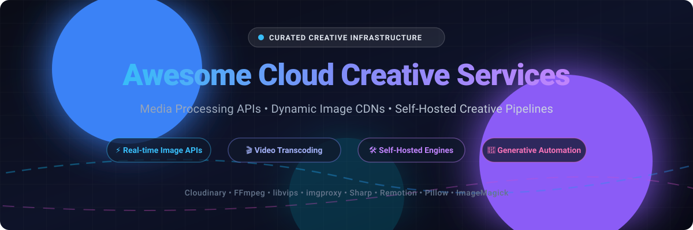

# 🎨 Awesome Cloud Creative Services

**A Curated Directory of Cloud Creative Services, Media Processing APIs, and High-Performance Self-Hosted Image & Video Pipelines.**

*Real-time image manipulation, cloud video transcoding, programmatic creative automation, dynamic CDNs, and media infrastructure.*

**Last updated: October 2026**

---

## 📖 Overview

Modern web applications, e-commerce storefronts, and social platforms generate millions of creative assets every day. Building and maintaining redundant encoding clusters, graphic transformation microservices, and media CDN caching layers from scratch can be cost-prohibitive and operationally complex.

This repository tracks the leading **managed SaaS platforms** and **battle-tested open-source projects** powering the **Cloud Creative Services** ecosystem. Whether you need an off-the-shelf programmable media API or a scalable, self-hosted media pipeline without recurring SaaS fees, this index serves as your architectural compass.

### 🔍 Key Capabilities Covered
- 🖼️ **Dynamic Image Transformation**: On-the-fly resizing, cropping, format conversion (AVIF/WebP), and artistic filters.
- 🎥 **Cloud Video Transcoding & Streaming**: Scalable HLS/DASH packaging, encoding, and smart thumbnail generation.
- 🎨 **Programmatic Creative Generation**: Automated banner generation, social preview graphics, and personalized PDFs from templates.
- ⚡ **High-Performance Self-Hosting**: Demand-driven C/Go/Rust engines for sub-millisecond, low-memory media processing.

---

## 📑 Table of Contents

- [📊 Sector Overview & Market Dynamics](#-sector-overview--market-dynamics)
- [☁️ SaaS & Hosted Platforms](#️-saas--hosted-platforms)
- [🛠️ Open-Source GitHub Projects](#️-open-source-github-projects)
  - [Top Projects (Ranked by Stars)](#top-projects-ranked-by-stars)
  - [Specialized Engines & Libraries](#specialized-engines--libraries)
- [🤝 How to Contribute](#-how-to-contribute)
- [⚠️ Architecture & Cost Disclaimer](#️-architecture--cost-disclaimer)
- [💖 Support & Sponsorship](#-support--sponsorship)
- [📈 Star History](#-star-history)

---

## 📊 Sector Overview & Market Dynamics

The global cloud creative software and media processing API sector is estimated at approximately **$9.5B to $11.2B**, expanding steadily at a **6.7%–8.2% CAGR** as programmatic asset generation and generative AI workflows accelerate. 

While legacy desktop/creative suites (such as Adobe Creative Cloud) maintain enterprise dominance for content creation, the headless media infrastructure and transformation API ecosystem is **moderately to highly fragmented** rather than winner-take-all. This fragmentation is propelled by specialized developer-first microservices (covering real-time edge image transformation, template-driven automation, and programmatic video rendering) paired with high-performance open-source engines that enable enterprises to self-host and avoid surging per-GB and per-transformation bandwidth charges.

---

## ☁️ SaaS & Hosted Platforms

Managed cloud services that provide robust media transformation APIs, globally distributed CDNs, and turnkey creative automation without managing underlying compute fleets.

| Product | Company Size (Valuation / Revenue) | Description | Pricing | Free Tier Limit |
| :--- | :--- | :--- | :--- | :--- |
| **[Adobe Creative Cloud](https://www.adobe.com/creativecloud/plans.html)** | ~$100B–$146B Market Cap / ~$23.8B Revenue (FY2025) | Comprehensive suite of 20+ creative desktop and web apps (Photoshop, Illustrator, Premiere Pro) with integrated cloud asset synchronization, collaboration, and generative AI features. | **Photography Plan**: **$9.99/mo** (billed annually). **Single App**: **$22.99/mo** (billed annually). **All Apps Standard**: **$54.99/mo**; **All Apps Pro**: **$69.99/mo** (billed annually). | **7-day free trial** of full Creative Cloud suite with generative AI credits (credit card required; converts to paid subscription if not canceled). No permanent free tier. |
| **[Cloudinary](https://cloudinary.com/)** | ~$2B Valuation / ~$100M+ ARR | Market-leading image and video management API featuring dynamic AI transformations, automated format optimization, and global CDN delivery. | **Plus**: **$89/mo** billed annually (or $99/mo, 225 credits/mo). **Advanced**: **$224/mo** billed annually ($249/mo, 600 credits/mo). **Pro PAYG**: usage-based overage tiers starting at standard sub. | **Free forever plan**: **25 credits/month** (~25,000 transformations, 25 GB storage, or 25 GB bandwidth on rolling 30-day window), up to 3 user seats, no credit card required. |
| **[imgix](https://imgix.com/)** | ~$11.5M Funding / ~$10M–$14M ARR | Real-time image processing engine coupled with an intelligent worldwide CDN for on-demand image optimization and visual search. | **Basic**: **$75/mo** (5,000 origin images, 500GB bandwidth, 5 sources, 5 users). **Growth**: **$300/mo** (25,000 images, 2.5TB bandwidth). | **Free forever plan**: **1,000 origin images, infinite transformations, 100GB bandwidth, 2 sources, 2 users** per month. |
| **[Renderforest](https://www.renderforest.com/)** | ~$12M Funding / ~$10.5M Revenue | All-in-one cloud creative platform offering automated video creation, logo generation, mockups, and website building with AI assistance. | **Lite**: **$8/mo** billed annually (4,800 credits). **Pro**: **$12/mo** billed annually first year (19,200 credits). **Business**: **$34.30/mo** billed annually first year (36,000 credits). | **Free forever plan**: 500MB cloud storage, up to 3-minute video exports capped at 360p/720p with permanent Renderforest watermark, and basic trial AI credits. |
| **[Filestack](https://www.filestack.com/)** | ~$1.92M Funding / Acquired (est. $5M–$10M Revenue) | Developer file upload widget, content ingestion network, file storage, transformation pipeline, and automated AI metadata tagging. | **Start**: **$69/mo** (20k uploads, 75GB bandwidth, 50k transformations, 50GB storage, 5 team members). **Grow**: **$199/mo**. **Scale**: **$379/mo**. | **Free forever plan**: **500 uploads, 1GB bandwidth, 1,000 transformations, 1GB storage, 1 team member** per month (advanced AI operations excluded). |
| **[Transloadit](https://transloadit.com/)** | Bootstrapped / ~$1.3M–$1.4M ARR | Versatile serverless file processing API enabling customized encoding pipelines for video, audio, documents, and images via declarative JSON assemblies. | **Lite**: **$29/mo** (15GB processing/mo). **Pro**: **$54/mo** billed annually (40GB processing, video turbo mode). | **Free forever plan**: **5GB processing/month**, 200 priority slots/region, 2 collaborators, 0.5GB file size limit, images watermarked, audio/video duration trimmed. |
| **[Bannerbear](https://www.bannerbear.com/)** | Bootstrapped / ~$1M ARR | REST API designed for auto-generating e-commerce banners, dynamic social media graphics, video clips, and PDF invoices from customizable templates. | **Automate**: **$50/mo** (200 AI credits, 1,000 image/video renders). **Scale 10k**: **$150/mo** (600 AI credits, 5,000 renders). **Enterprise 2m**: **$1,253/mo** (5,200 AI credits). | **Free trial**: **50 AI credits / test image generations** with no expiry and no credit card required. No permanent free tier. |
| **[Kraken.io](https://kraken.io/)** | Bootstrapped / ~$84K–$170K Revenue | Ultra-fast image optimization and lossless/lossy compression API with CMS plugins for WordPress, Magento, and Shopify. | **Micro**: **$5/mo** (500MB images). **Basic**: **$9/mo** (2GB). **Advanced**: **$19/mo** (5GB). **Premium**: **$39/mo** (15GB). | **Free trial account**: **100MB quota testing balance**, no credit card required, with full API feature access. No recurring free allowance. |

---

## 🛠️ Open-Source GitHub Projects

Self-hosted image transformation servers, video transcoding frameworks, and media manipulation engines. These tools form the foundational building blocks for private cloud creative services, giving you complete pipeline control and eliminating per-GB/per-transformation SaaS fees.

### Top Projects (Ranked by Stars)

- **[Remotion](https://github.com/remotion-dev/remotion)**   
  **Make videos programmatically using React.** Create MP4 videos dynamically with React components, CSS, canvas, and WebGL. Supports cloud rendering on AWS Lambda for massive horizontal scalability, making it ideal for personalized video generation and dynamic motion graphics.

- **[FFmpeg](https://github.com/FFmpeg/FFmpeg)**   
  **The universal video/audio transcoder.** The foundational, cross-platform multimedia framework capable of decoding, encoding, transcoding, muxing, demuxing, streaming, and filtering virtually every audio and video format known. Powers the encoding backends of nearly all commercial streaming and cloud creative platforms.

- **[Sharp](https://github.com/lovell/sharp)**   
  **High-performance Node.js image processing.** Built on top of libvips, Sharp is typically 4x–5x faster than ImageMagick and GraphicsMagick. It efficiently handles JPEG, PNG, WebP, AVIF, and TIFF images with automatic memory reclamation, making it the premier choice for Node.js backend microservices.

- **[HandBrake](https://github.com/HandBrake/HandBrake)**   
  **Open-source video transcoder.** A versatile video conversion engine with built-in presets for web and mobile devices, hardware-accelerated encoding (NVENC, Intel QSV, Apple VideoToolbox), and batch processing capabilities.

- **[ImageMagick](https://github.com/ImageMagick/ImageMagick)**   
  **The foundational image processing toolkit.** Ubiquitous command-line tools and C APIs for reading, converting, editing, compositing, and writing raster and vector images across more than 200 formats. A bedrock utility in web and CMS servers worldwide.

- **[Pillow](https://github.com/python-pillow/Pillow)**   
  **The friendly Python Imaging Library (PIL fork).** The standard Python library for image manipulation, pixel-level editing, filter pipelines, and dynamic banner/watermark generation. Crucial for Python-based creative and machine learning workflows.

- **[libvips](https://github.com/libvips/libvips)**   
  **A fast, low-memory image processing engine.** Features a demand-driven, multi-threaded streaming architecture that processes large images without loading entire uncompressed bitmaps into RAM. Powers engines like imgproxy and Sharp.

- **[imgproxy](https://github.com/imgproxy/imgproxy)**   
  **Fast and secure standalone image processing server.** Written in Go with libvips under the hood, imgproxy is designed for extreme throughput and security. Features HMAC-signed URL authorization, stateless Dockerized deployments, and native cloud storage integration (AWS S3, Google Cloud Storage, Azure Blob).

- **[Thumbor](https://github.com/thumbor/thumbor)**   
  **Smart, on-demand image cropping and resizing service.** Written in Python, Thumbor provides smart facial and feature detection cropping, URL signature verification, and pluggable extraction and storage backends.

- **[pngquant](https://github.com/kornelski/pngquant)**   
  **Lossy PNG compressor library and CLI.** Converts 24/32-bit PNGs to 8-bit palette PNGs with full alpha transparency, reducing file size by 60%–80% with minimal visual degradation.

- **[Imagick (Go)](https://github.com/gographics/imagick)**   
  **Go bindings to ImageMagick's MagickWand API.** Enables native Go microservices to invoke ImageMagick C-bindings for deep programmatic image compositing, drawing, and format conversions.

### Specialized Engines & Libraries

- **[vips-ffm](https://github.com/libvips/vips-ffm)**  — The FFmpeg integration plugin for libvips, allowing instant video frame extraction and poster image generation directly within libvips pipelines.
- **[sharp-cli](https://github.com/vsemozhetbyt/sharp-cli)**  — CLI interface for Sharp, bringing high-speed libvips transformations to shell scripts and CI/CD pipelines.

---

## 🤝 How to Contribute

Contributions are warmly welcomed! Help keep this ecosystem comprehensive, accurate, and up-to-date:

1. **Fork the repository** to your personal GitHub account.
2. **Add or refine entries** in `README.md`:
   - Follow the established markdown table or list structure.
   - For SaaS products, include exact pricing tiers, company size, and specific free tier limits.
   - For open-source projects, include the social stars badge linked to stargazers.
3. **Validate links and facts**: Ensure URLs resolve correctly and descriptions remain strictly factual.
4. **Submit a Pull Request** with a concise description of your additions.

---

## ⚠️ Architecture & Cost Disclaimer

- **SaaS Pricing Nuances**: Pay-as-you-go and credit-based plans can become unpredictable at scale. Overage charges on video transcoding and high-resolution transformations frequently exceed initial monthly estimates. Always model peak consumption before committing to annual enterprise contracts.
- **Self-Hosting Economics**: Below ~100,000 monthly transformations, managed SaaS CDNs (e.g., Cloudinary, imgix) are often more cost-effective due to zero DevOps overhead. However, at enterprise scale (10M+ requests/month), self-hosted solutions like **imgproxy** paired with object storage (S3/GCS) can reduce infrastructure costs by up to **60x–100x**.
- **Independent Directory**: This curated repository is maintained for community education and architectural reference. Mentions do not constitute commercial endorsements.

---

## 💖 Support & Sponsorship

If this curated guide helps you architect your media infrastructure or save costs on creative cloud services, please consider supporting the project:

- ⭐ **Star the repository** to boost visibility for other developers.
- 🍴 **Fork and contribute** your favorite media libraries and pipelines.
- 📢 **Share with your team** and on social channels.
- ☕ **Sponsor the maintainer**: Buy a coffee or support ongoing maintenance via the [GitHub Sponsors Dashboard](https://github.com/sponsors/ishandutta2007).

---

## 📈 Star History

---

**Built with ❤️ for developers, creative technologists, and cloud media architects.**

